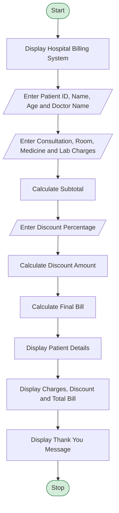

# Problem Statement
The aim of this project is to develop a Hospital Billing System using Python that calculates the total medical expenses of a patient. The program accepts patient details such as patient ID, name, age, and doctor name. It also accepts charges for consultation, room, medicines, and laboratory tests.

The system calculates the subtotal, applies the discount percentage, and displays the final bill amount along with the patient's details in a formatted bill receipt. This program helps simplify hospital billing and reduces manual calculation errors.
# Algorithm
Start the program.

Display the title “Hospital Billing System”.

Enter the patient's ID, name, age, and doctor name.

Enter the consultation fee, room charges, medicine charges, and laboratory charges.

Calculate the subtotal by adding all the charges.

Subtotal
=
Consultation Fee
+
Room Charges
+
Medicine Charges
+
Laboratory Charges
Subtotal=
​
  
Consultation Fee
+Room Charges
+Medicine Charges
+Laboratory Charges
​
 
Enter the discount percentage.

Calculate the discount amount.

Discount
=
Subtotal
×
Discount %
100
Discount= 
100
Subtotal×Discount %
​
 
8. Calculate the final bill amount.

Total Bill
=
Subtotal
−
Discount
Total Bill=Subtotal−Discount
Display the patient details, individual charges, subtotal, discount, and total bill.

Display the thank-you message.

Stop the program.

# Mermaid Flowchart

# Input
The program requires the following inputs from the user.

Input

Sample value

Patient ID

101

Patient Name

Ravi

Patient Age

25

Doctor Name

Dr. Kumar

Consultation Fee

₹500

Room Charges

₹2000

Medicine Charges

₹800

Laboratory Charges

₹700

Discount Percentage

10%

# Expected Output

text
=============================================
         HOSPITAL BILLING SYSTEM
=============================================
Patient ID       : 101
Patient Name     : Ravi
Age              : 25
Doctor Name      : Dr. Kumar
---------------------------------------------
Consultation Fee : ₹500.00
Room Charges     : ₹2000.00
Medicine Charges : ₹800.00
Laboratory Fee   : ₹700.00
---------------------------------------------
Subtotal         : ₹4000.00
Discount         : ₹400.00
---------------------------------------------
TOTAL BILL       : ₹3600.00
=============================================
Thank you for choosing our hospital!
=============================================
