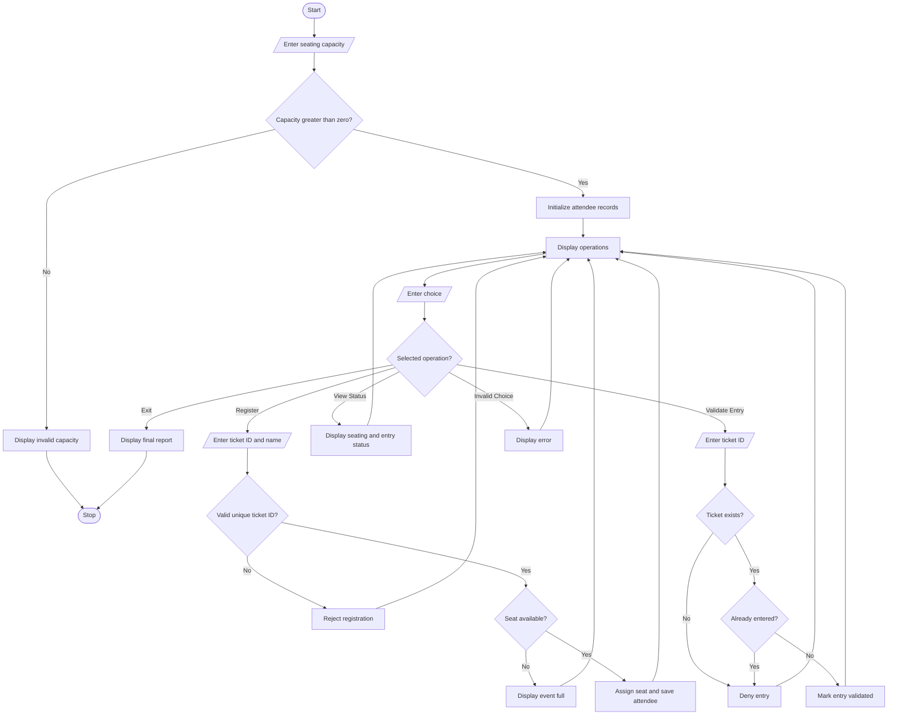

# Problem statement
Develop a Python-based Campus Event Seating and Entry Validation System to manage attendee registrations and entry for campus events. The system should accept a unique ticket ID and attendee name, assign a seat according to the available capacity, and validate ticket IDs at the entrance.

It must prevent duplicate registrations, reject invalid tickets, deny repeated entry attempts, and prevent registrations beyond the seating capacity. The system should also display the total number of registered attendees, occupied seats, available seats, and validated entries.

# Algorithm
Start the program.

Input the total seating capacity.

Initialize the attendee records and occupied-seat count.

Display the available operations.

Accept the user's choice.

If registration is selected:

Input the ticket ID and attendee name.

Check that the fields are not empty.

Verify that the ticket ID is unique.

Check whether seats are available.

Assign a seat and store the attendee details.

If entry validation is selected:

Input the ticket ID.

Check whether the ticket exists.

If the ticket is invalid or already used, deny entry.

Otherwise, mark the entry as validated.

If seating status is selected, display capacity, registrations, available seats, and validated entries.

If exit is selected, display the final event report.

Repeat until the user exits.

Stop the program.

# Mermaid flowchart 

# Sample input

text
===== CAMPUS EVENT MANAGEMENT =====
Enter total seating capacity: 3

1. Register attendee
2. Validate entry
3. View seating status
4. Exit

Enter your choice: 1
Enter ticket ID: EVT101
Enter attendee name: Ravi
6. Sample output

text
Registration successful!
Attendee: Ravi
Assigned seat: 1
After validating the ticket:

text
Enter your choice: 2
Enter ticket ID: EVT101

Entry validated successfully!
Welcome, Ravi
Seat number: 1
If the same ticket is used again:

text
Enter your choice: 2
Enter ticket ID: EVT101

Duplicate entry detected. Entry denied.
