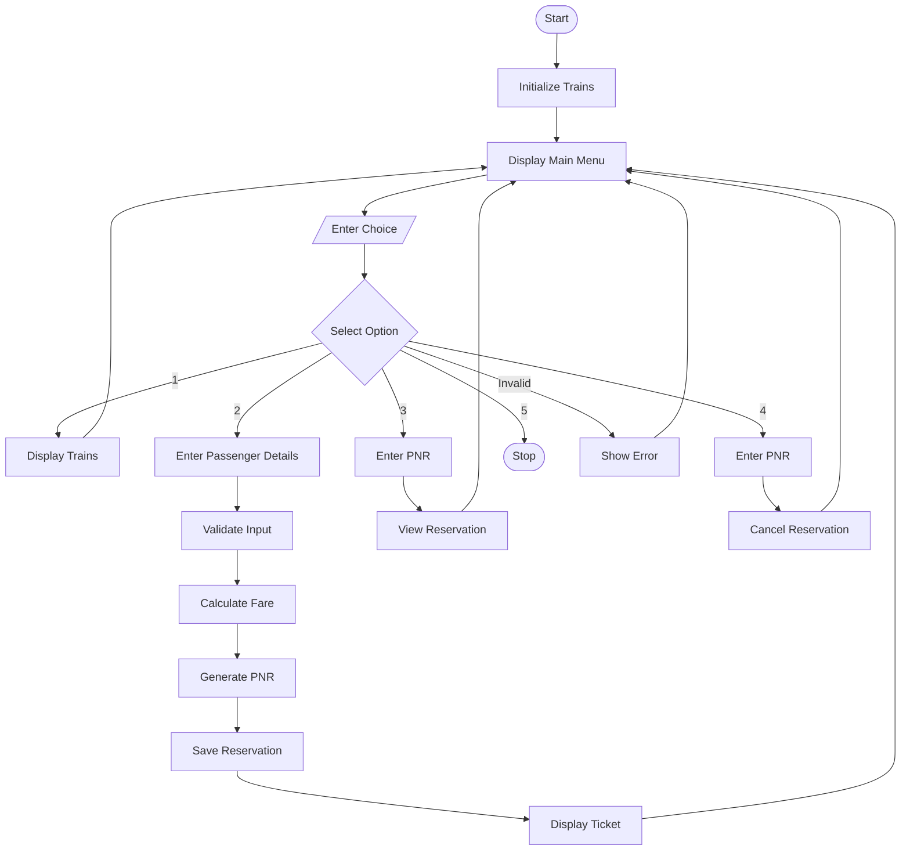

# Problem Statement
The Railway Fare and Reservation Calculator is a Python-based application designed to simplify the process of calculating railway ticket fares and managing passenger reservations. The system allows users to view available trains, select a train and travel class, enter passenger and journey details, calculate the total ticket fare, and generate a reservation confirmation with a unique PNR number.

The application also provides options to view existing reservations and cancel tickets using the PNR number. It validates user inputs to reduce errors during booking. This project uses predefined train fares and stores reservations temporarily in memory.

Objective: To develop a simple, menu-driven railway reservation system using Python that automates fare calculation and basic ticket reservation operations.

# Algorithm
Start the program.

Initialize the available trains with their names and base fares.

Create an empty list to store reservation details.

Display the main menu:

Display available trains.

Book a ticket.

View a reservation.

Cancel a reservation.

Exit.

Accept the user's choice.

Perform the selected operation:

Display trains: Show train numbers, names, and fares.

Book ticket: Accept passenger details, source, destination, journey date, number of passengers, and travel class.

Validate the entered details.

Calculate the fare per person based on the selected class.

Calculate the total fare by multiplying the fare per person by the number of passengers.

Generate a PNR number and store the reservation.

Display the reservation confirmation.

View reservation: Accept the PNR number and display the corresponding reservation details.

Cancel reservation: Accept the PNR number and remove the matching reservation.

Exit: Terminate the program.

If the input is invalid, display an appropriate error message.

Repeat the menu until the user chooses Exit.

Stop.

3. Mermaid Flowchart
The following flowchart represents the overall working of the Railway Fare and Reservation Calculator.

## Railway Fare and Reservation Calculator - Flowchart

# Input
The program accepts the following inputs from the user.

Input

Description

Example

Menu choice

Operation to perform

2

Train number

Selected train

1

Passenger name

Name of the passenger

Rahul

Passenger age

Age of the passenger

22

Source station

Starting station

Vijayawada

Destination station

Destination station

Chennai

Journey date

Date of travel

15-12-2026

Number of passengers

Total passengers in booking

2

Travel class

Selected class

AC 3 Tier

PNR number

Used to view or cancel a booking

Generated PNR

Sample input

text
Enter your choice (1-5): 2

Enter train number: 1
Enter passenger name: Rahul
Enter passenger age: 22
Enter source station: Vijayawada
Enter destination station: Chennai
Enter journey date (DD-MM-YYYY): 15-12-2026
Enter number of passengers: 2

Available classes:
1. Sleeper
2. AC 3 Tier
3. AC 2 Tier
4. AC First Class

Select class (1-4): 2
5. Expected Output
For the sample input, the selected Express Train has a base fare of ₹150 per person. The AC 3 Tier class uses a fare multiplier of 1.5.

Fare per person
=
150
×
1.5
=
₹
225
Fare per person=150×1.5=₹225
Total fare
=
225
×
2
=
₹
450
Total fare=225×2=₹450

text
====== RESERVATION CONFIRMED ======
PNR Number       : [Generated PNR]
Passenger Name   : Rahul
Age              : 22
Train            : Express Train
From             : Vijayawada
To               : Chennai
Journey Date     : 15-12-2026
Passengers       : 2
Class            : AC 3 Tier
Fare per person  : Rs. 225.00
Total Fare       : Rs. 450.00
===================================
Result: The Railway Fare and Reservation Calculator successfully calculates the ticket fare, generates a PNR number, and supports basic reservation viewing and cancellation using Python. The fares are illustrative, and reservations are retained only while the program is running.

