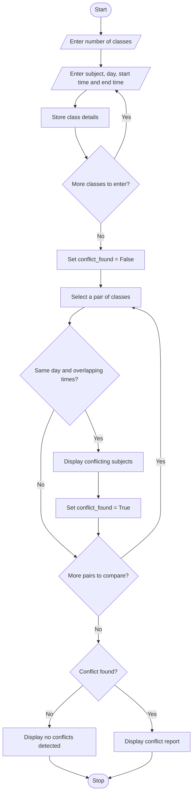

# Problem Statement
Develop a Python program to detect timetable conflicts for students by checking whether two or more classes are scheduled at overlapping times on the same day.

The program should accept the subject name, day, start time, and end time for each class. It should compare the schedules and identify any overlapping classes. If a conflict exists, the program should display the conflicting subjects and their time slots; otherwise, it should display a message indicating that no conflicts were found.

# Algorithm
Start the program.

Read the number of classes.

For each class, input the subject name, day, start time, and end time.

Store the timetable details in a list.

Initialize conflict_found to False.

Compare each class with every subsequent class.

Check whether both classes occur on the same day.

Check whether their time intervals overlap.

If both conditions are true, display the conflicting subjects and set conflict_found to True.

If no conflicts are detected, display “No timetable conflicts detected.”

Stop the program.

# Mermaid Flowchart

# Sample Input

text
Enter the number of classes: 3

Enter details for class 1
Enter subject name: Mathematics
Enter day: Monday
Enter start time: 9
Enter end time: 11

Enter details for class 2
Enter subject name: Physics
Enter day: Monday
Enter start time: 10
Enter end time: 12

Enter details for class 3
Enter subject name: English
Enter day: Tuesday
Enter start time: 9
Enter end time: 10
6. Sample Output

text
===== TIMETABLE CONFLICT REPORT =====
Conflict: Mathematics (9:00-11:00) and Physics (10:00-12:00) on Monday
====================================
# Result
The Python program successfully detects timetable conflicts by comparing the days and time intervals of classes. It displays all overlapping class pairs and reports when no conflicts are detected.

Note: This simplified program uses whole-hour times, such as 9 for 9:00 AM and 14 for 2:00 PM. It can be extended to support minutes, classroom conflicts, and student-specific schedules.

