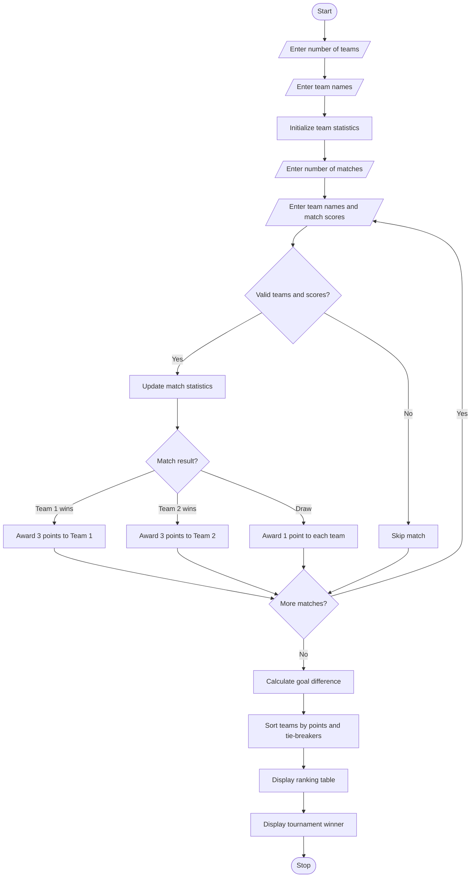

# Problem Statement
Develop a Python program to manage a sports tournament ranking system. The program should accept the names of teams or players and their match scores, calculate the total points earned by each team, and rank them according to their performance.

The system awards 3 points for a win, 1 point for a draw, and 0 points for a loss. It should display the teams in descending order of points, using score difference as a tie-breaker, and identify the tournament winner.
# Algorithm
Start the program.

Read the number of teams participating in the tournament.

Enter each team name and initialize its statistics to zero.

Read the number of matches.

For each match:

Enter the two team names and their scores.

Validate the team names and scores.

Update matches played, wins, draws, losses, goals scored, and goals conceded.

Award 3 points for a win, 1 point for a draw, and 0 points for a loss.

Calculate each team's goal difference.

Sort the teams by total points in descending order.

If points are equal, use goal difference and then goals scored as tie-breakers.

Display the tournament ranking table.

Display the highest-ranked team as the tournament winner.

Stop the program.

# Mermaid Flowchart

# Sample Input

text
Enter the number of teams: 3
Enter team 1 name: Tigers
Enter team 2 name: Lions
Enter team 3 name: Eagles

Enter the number of matches: 3

Match 1
Enter first team: Tigers
Enter second team: Lions
Enter Tigers score: 3
Enter Lions score: 1

Match 2
Enter first team: Eagles
Enter second team: Tigers
Enter Eagles score: 2
Enter Tigers score: 2

Match 3
Enter first team: Lions
Enter second team: Eagles
Enter Lions score: 2
Enter Eagles score: 0
6. Sample Output

text
========== TOURNAMENT RANKING ==========
Rank  Team           P    W    D    L    Pts   GD
1     Tigers         2    1    1    0    4     2
2     Lions          2    1    0    1    3     0
3     Eagles         2    1    0    1    3    -2

Tournament Winner: Tigers
========================================
# Result
The Sports Tournament Ranking System successfully records match results, calculates team points, ranks teams using points and goal difference, and displays the tournament winner.

Note: This example uses football-style scoring rules. You can modify the points system and tie-breakers to suit cricket, basketball, badminton, or other sports.

