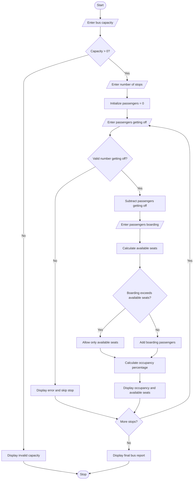

# Problem Statement
Develop a Python program to simulate passenger occupancy in a bus. The program should accept the maximum seating capacity of the bus and the number of passengers boarding and getting off at each stop.

The system should update the number of passengers after each stop, ensure that the bus does not exceed its capacity, prevent the passenger count from becoming negative, and display the current occupancy and available seats. At the end of the simulation, it should display the final number of passengers and the total number of available seats.

# Algorithm
Start the program.

Input the maximum capacity of the bus.

Check whether the capacity is positive. If not, display an error message.

Input the number of bus stops.

Initialize the passenger count to zero.

For each bus stop:

Input the number of passengers getting off.

Validate that the number is not negative or greater than the current passenger count.

Subtract the passengers getting off.

Input the number of passengers boarding.

Validate the boarding count.

Check the available seats.

Allow passengers to board up to the remaining capacity.

Calculate occupancy percentage.

Display the passenger count, available seats, and occupancy rate.

After all stops, display the final bus occupancy report.

Stop the program.

# Mermaid Flowchart

# Sample Input

text
Enter bus capacity: 40
Enter number of bus stops: 3

--- Bus Stop 1 ---
Passengers getting off: 0
Passengers boarding: 15

--- Bus Stop 2 ---
Passengers getting off: 5
Passengers boarding: 20

--- Bus Stop 3 ---
Passengers getting off: 10
Passengers boarding: 8
6. Sample Output

text
--- Bus Stop 1 ---
Current passengers: 15
Available seats: 25
Occupancy rate: 37.50%

--- Bus Stop 2 ---
Current passengers: 30
Available seats: 10
Occupancy rate: 75.00%

--- Bus Stop 3 ---
Current passengers: 28
Available seats: 12
Occupancy rate: 70.00%

===== FINAL BUS REPORT =====
Bus capacity: 40
Final passengers: 28
Available seats: 12
Final occupancy: 70.00%
============================
# Result
The Bus Passenger Occupancy Simulation successfully tracks passenger boarding and departure at each stop, prevents the bus from exceeding its capacity, and displays occupancy percentages and available seats throughout the journey.

Note: This program assumes that the bus starts empty and that its capacity represents the maximum number of passengers allowed onboard.

