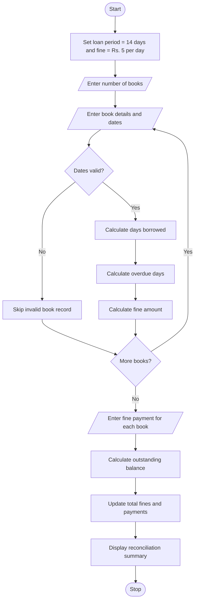

# Problem statement
Develop a Python program to manage library book borrowing and fine reconciliation. The program should accept book details, borrowing dates, and return dates. It should calculate the number of days each book was borrowed, determine overdue days based on a 14-day loan period, and calculate fines at ₹5 per overdue day.

The program should also record payments made against each fine, calculate outstanding balances, and display a summary of total fines, payments collected, and unpaid fines.

# Algorithm
Start the program.

Set the loan period to 14 days and the fine rate to ₹5 per overdue day.

Input the number of books.

For each book, enter its ID, name, borrowing date, and return date.

Validate the date format and ensure the return date is not before the borrowing date.

Calculate the number of days borrowed.

Calculate overdue days as the number of borrowed days exceeding 14.

Calculate the fine as overdue days multiplied by ₹5.

Enter the amount paid for each fine.

Validate the payment and calculate the outstanding balance.

Update total fines, payments collected, and outstanding fines.

Display the final reconciliation report.

Stop the program.

# Mermaid flowchart 

# Sample input

text
Enter number of books to borrow: 2

Book 1
Enter book ID: B101
Enter book name: Python Basics
Enter borrow date (YYYY-MM-DD): 2026-01-01
Enter return date (YYYY-MM-DD): 2026-01-20

Book 2
Enter book ID: B102
Enter book name: Data Structures
Enter borrow date (YYYY-MM-DD): 2026-01-01
Enter return date (YYYY-MM-DD): 2026-01-10
6. Sample output
For the first book, 19 days were borrowed, so the overdue period is 5 days and the fine is ₹25. The second book has no fine because it was returned within the loan period.

text
===== LIBRARY FINE RECONCILIATION =====

Book: Python Basics (ID: B101)
Days borrowed: 19
Overdue days: 5
Fine amount: Rs. 25.00
Enter fine amount paid: 15
Fine paid: Rs. 15.00
Outstanding fine: Rs. 10.00

Book: Data Structures (ID: B102)
Days borrowed: 9
Overdue days: 0
Fine amount: Rs. 0.00
Enter fine amount paid: 0
Fine paid: Rs. 0.00
Outstanding fine: Rs. 0.00

========== FINAL SUMMARY ==========
Books processed: 2
Total fines: Rs. 25.00
Total payments: Rs. 15.00
Outstanding fines: Rs. 10.00
===================================
