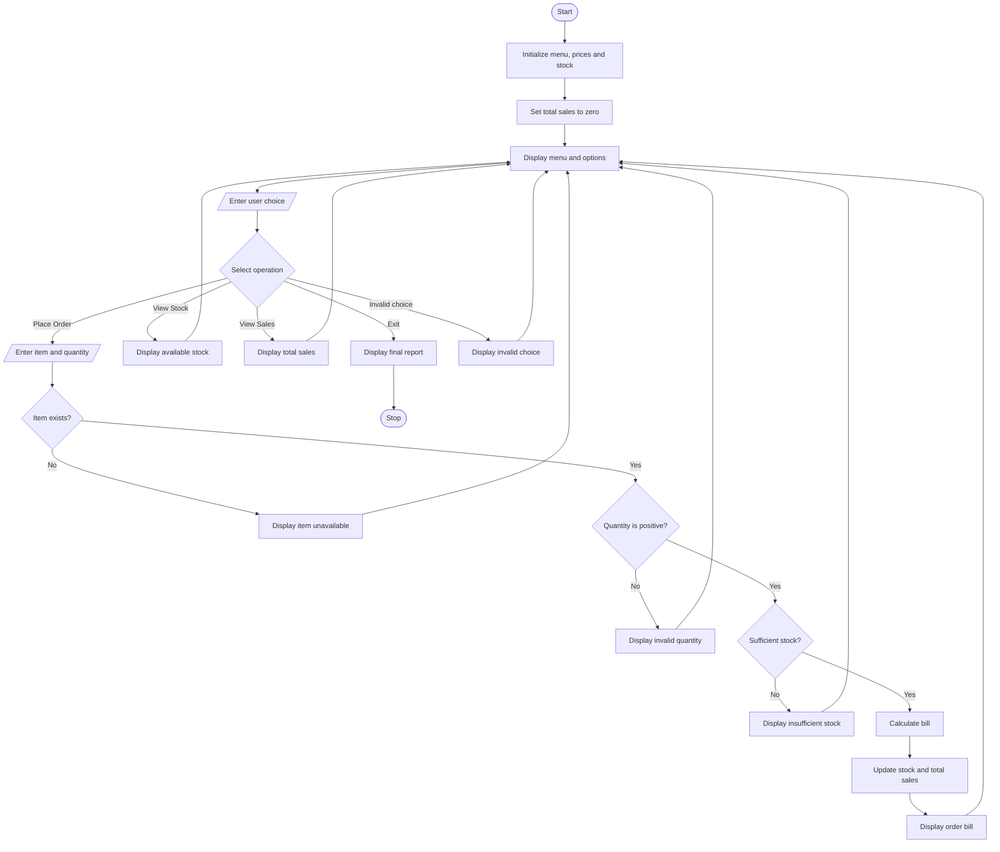

# Problem statement
Develop a Python-based Smart Canteen Order and Stock Management System to manage food orders and inventory efficiently. The system should display a menu with food prices and available stock, allow customers to place orders, verify stock availability, calculate the total bill, and automatically update inventory after successful orders.

It should also provide options to view the current stock and total sales. The system must prevent orders with invalid quantities or insufficient stock and generate a final sales and inventory report when the user exits.

# Algorithm
Start the program.

Initialize the food menu with item names, prices, and stock quantities.

Initialize total sales to zero.

Display the menu and available operations.

Ask the user to select an operation.

If the user chooses to place an order:

Read the food item and quantity.

Check whether the item exists in the menu.

Validate that the quantity is positive.

Check whether sufficient stock is available.

Calculate the bill.

Deduct the ordered quantity from stock.

Update total sales and display the bill.

If the user chooses to view stock, display available quantities.

If the user chooses to view sales, display total sales.

If the user chooses to exit, display the final sales and stock report.

Repeat until the user exits.

Stop the program.

# Mermaid flowchart

# Sample input

text
===== SMART CANTEEN MANAGEMENT =====

1. Place Order
2. View Stock
3. View Sales
4. Exit

Enter your choice: 1
Enter food item: Dosa
Enter quantity: 2
6. Sample output

text
--- ORDER CONFIRMED ---
Item: Dosa
Quantity: 2
Price per item: Rs. 50.00
Total bill: Rs. 100.00
Order placed successfully!
If the user orders more than the available quantity, the system displays an insufficient-stock message and does not deduct any stock.
